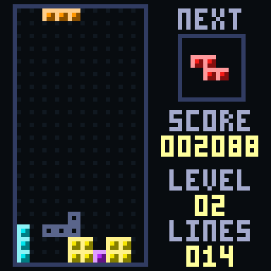
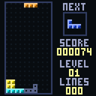
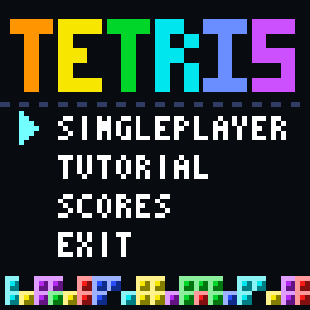
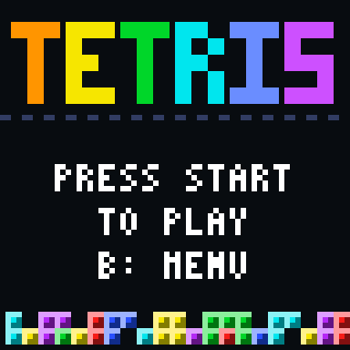
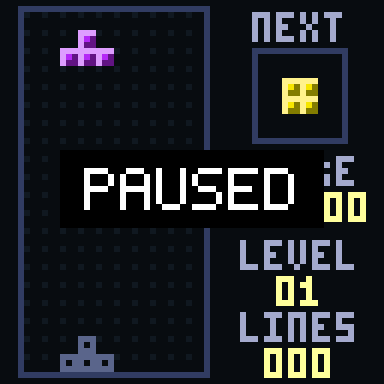
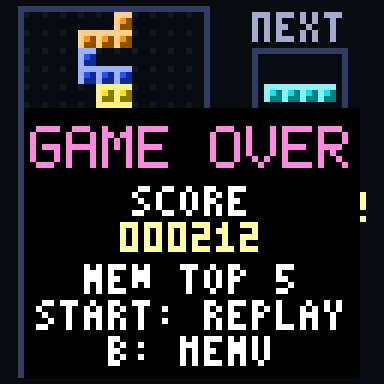
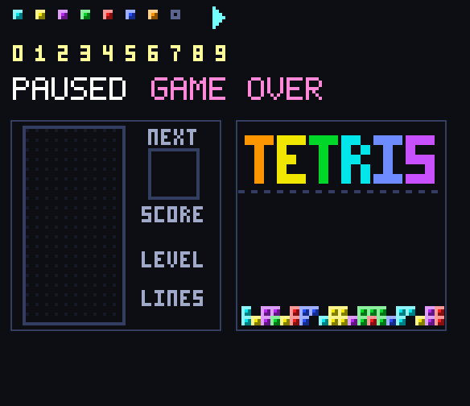

# Tetris

Tetris es el clásico videojuego de rompecabezas creado por Alexey Pajitnov en 1984 y popularizado por Nintendo a finales de los años 80. Es uno de los videojuegos más conocidos de la historia.

En este juego, el jugador recibe piezas de cuatro bloques que caen por un tablero. Debe moverlas y rotarlas para completar líneas horizontales, que desaparecen y dan puntos.

La experiencia combina rapidez, planeación y reflejos, ya que las piezas caen cada vez más rápido y el tablero se llena si no se completan líneas a tiempo.

|  | |
| :---: | :---: |
|  |  |

> La animación muestra a un jugador automático de las pruebas jugando.

## Características del juego

- Tablero de 10 columnas por 20 filas.
- Las 7 piezas clásicas: I, O, T, S, Z, J y L.
- Rotación a la derecha y a la izquierda con el sistema estándar SRS: si la pieza no cabe al girar, se prueba moverla a los lados y hacia arriba. Así gira también apoyada en el piso, sobre la pila y junto a las paredes.
- Piezas en "bolsas de 7": cada bolsa trae las 7 piezas una vez, en orden aleatorio.
- Caída automática, cada vez más rápida con el nivel.
- Caída suave y caída directa.
- Repetición automática al mantener izquierda o derecha.
- Líneas de 1 a 4 a la vez.
- Puntaje y nivel, que sube cada 10 líneas.
- Vista de la pieza siguiente.
- Sombra que muestra dónde caerá la pieza.
- Pantallas de inicio, pausa, tutorial, puntajes y fin de partida.
- Tabla de los 5 mejores puntajes.
- Efectos de sonido.
- Sistema visual basado en sprites.
- Ambientación inspirada en los videojuegos arcade clásicos.

## Objetivo

El objetivo del juego es conseguir el mayor puntaje posible antes de que el tablero se llene.

Durante la partida, el jugador debe:

- Mover y rotar cada pieza para que encaje.
- Completar líneas horizontales sin dejar huecos.
- Apuntar a limpiar 4 líneas a la vez, que da más puntos.
- Anticipar la pieza siguiente.
- Adaptarse a la velocidad, que aumenta con cada nivel.

La partida termina cuando una pieza nueva ya no cabe en el tablero.

## Controles

| Acción | Control |
|---|---|
| Mover la pieza a la izquierda | Flecha izquierda |
| Mover la pieza a la derecha | Flecha derecha |
| Caída suave | Flecha abajo |
| Caída directa | Flecha arriba |
| Rotar a la derecha | Tecla A |
| Rotar a la izquierda | Tecla B |
| Iniciar o pausar | Enter |
| Confirmar en los menús | Enter o tecla A |
| Volver en los menús | Tecla B |

Los controles equivalentes de la consola son los botones del control NES: izquierda, derecha, abajo, arriba, A, B y Start.

No hay "guardar pieza": ese botón sería Select, y el simulador del HAL no lo lee.

## Puntaje

| Líneas a la vez | Puntos |
|---|---|
| 1 | 40 × nivel |
| 2 | 100 × nivel |
| 3 | 300 × nivel |
| 4 | 1200 × nivel |

El "nivel" es el que se ve en pantalla, que empieza en 1.

Además, la caída suave da 1 punto por cada fila que baja la pieza y la caída directa da 2 puntos por fila.

El nivel sube cada 10 líneas completadas, hasta el nivel 15. En cada nivel la pieza cae más rápido: del nivel 0, con una fila cada 26 cuadros, al nivel 15, con una fila por cuadro. El puntaje máximo es 999999.

## Pantallas

El flujo de pantallas sigue el [diagrama del menú e inicio de juego](../docs/diagramas): submenú (Singleplayer, Tutorial, Scores y Exit), pantalla "Press start to play", partida, pausa y fin de partida. La opción Multiplayer del diagrama no aplica a Tetris, que es de un solo jugador.

| Menú | Inicio | Pausa | Fin de partida |
| :---: | :---: | :---: | :---: |
|  |  |  |  |

En la pantalla de fin de partida se muestra el puntaje y, si entró entre los 5 mejores, el aviso "NEW TOP 5". Start empieza otra partida y B vuelve al menú.

## Diseño visual

El juego utiliza una estética inspirada en las máquinas arcade de los años 80.

La pantalla de KUBIX mide 64×64 píxeles. Cada bloque mide 3×3 píxeles, así que el tablero ocupa 30×60 píxeles a la izquierda, y a la derecha queda un panel con la pieza siguiente, el puntaje, el nivel y las líneas.

Los recursos gráficos están pensados para representar:

- Los 7 bloques de colores, uno por pieza.
- El bloque de la sombra.
- El fondo de la cancha, con el marco del tablero y el panel lateral.
- Los dígitos del marcador.
- El fondo del menú con el título "TETRIS" y el cursor de selección.
- Los rótulos de pausa y fin de partida.
- La identidad visual retro del juego.

<div align="center">
  
</div>

## Desarrollo del juego

Tetris cuenta con una versión desarrollada en lenguaje C, con una estructura orientada a sistemas retro y videojuegos de recursos limitados. Las reglas del juego están separadas de la pantalla y del teclado, por lo que se pueden probar sin SDL2, igual que en Pong.

Actualmente, el juego cuenta con:

- Submenú con Singleplayer, Tutorial, Scores y Exit.
- Pantalla de inicio, partida, pausa, tutorial, puntajes y fin de partida.
- Las 7 piezas con rotación, sombra y vista de la pieza siguiente.
- Bolsas de 7, gravedad por nivel y limpieza de líneas.
- Puntaje, nivel, líneas y tabla de los mejores 5 puntajes.
- Sonido al rotar, fijar, limpiar líneas, subir de nivel y terminar.
- Sprites y fondos gráficos.
- Pruebas automáticas de la lógica.

Estado de cada parte:

- [x] README con el diseño del juego.
- [x] Estructura de carpetas, CMake y guía de compilación.
- [x] Sprites: bloques, cancha, menú, cursor, rótulos y dígitos.
- [x] Lógica: tablero, piezas, rotación, bolsas de 7, gravedad, líneas y puntaje.
- [x] Pruebas automáticas de la lógica (144 pruebas, 100 % de las líneas).
- [x] Pantallas: menú, tutorial, partida, pausa, fin de partida y puntajes.
- [x] Efectos de sonido, conectados al juego.
- [x] Capturas y animación en este README.
- [x] Verificación con SDL2 real (compila con CMake y arranca).

### Reglas

- Las piezas salen de una bolsa de 7: cada tipo sale una vez por bolsa, así que una pieza concreta nunca tarda más de 12 piezas seguidas en volver a salir.
- Cada pieza aparece en la parte superior central del tablero.
- La rotación usa el sistema estándar SRS: si la pieza no cabe, se prueban hasta 4 posiciones más (a los lados y hacia arriba o abajo). La I tiene su propia tabla.
- Cada pieza aparece ya visible en la parte superior central del tablero.
- Si "abajo" sigue presionado cuando se fija una pieza, la siguiente no cae rápido hasta que se suelte la tecla.
- Al perder, los botones se ignoran un instante para no saltarse la pantalla del resultado.
- La caída directa deja la pieza en su sitio al instante.
- Una pieza se fija cuando ya no puede bajar más.
- Al completar una fila, esta desaparece y las de arriba bajan.

## Estructura de carpetas del juego

```text
Tetris/
├── CMakeLists.txt
├── README.md
├── forDev.md
├── assets/
│   ├── BloqueI.png, BloqueO.png, BloqueT.png, BloqueS.png
│   ├── BloqueZ.png, BloqueJ.png, BloqueL.png, BloqueSombra.png
│   ├── Cancha.png
│   ├── MenuTetris.png
│   ├── Cursor.png
│   ├── LabelPaused.png, LabelGameOver.png
│   ├── Dig0.png ... Dig9.png
│   └── tetris_rotar.wav, tetris_fijar.wav, tetris_linea.wav,
│       tetris_cuatro.wav, tetris_nivel.wav, tetris_fin.wav
├── src/
│   ├── main.c
│   └── tetris_logica.c
├── include/
│   ├── assets.h
│   ├── basic_font.h
│   ├── hal.h
│   └── tetris_logica.h
├── tests/
│   ├── jugadores_bot.h
│   └── tetris_tests.c
└── img/
    ├── juego.png, menu.png, inicio.png, pausa.png, fin.png
    ├── assets_tetris.png
    └── tetris_demo.gif
```

| Carpeta o archivo | Contenido |
|---|---|
| `CMakeLists.txt` | Compilación del juego y de las pruebas con CMake y SDL2. |
| `forDev.md` | Guía de compilación y ejecución. |
| `assets/` | Sprites PNG (bloques, cancha, menú, cursor, rótulos y dígitos) y 6 efectos de sonido. |
| `src/main.c` | Pantallas, entrada de controles, dibujo y sonido. |
| `src/tetris_logica.c` | Reglas: piezas, rotación, gravedad, líneas y puntaje. No depende de SDL. |
| `include/assets.h` | Sprites en RGB565, generado a partir de [`Tetris/assets`](./assets) con [`TOOLS/converter.py`](../TOOLS/converter.py). |
| `include/hal.h`, `include/basic_font.h` | Capa de hardware y fuente de texto, las mismas de roadFighter y Pong. |
| `include/tetris_logica.h` | Interfaz de la lógica del juego. |
| `tests/` | Pruebas automáticas de la lógica y un jugador automático para probar la jugabilidad. |
| `img/` | Capturas y animación que se muestran en este README. |

## Tecnologías utilizadas

- Lenguaje C.
- SDL2.
- CMake.
- Sprites gráficos.
- Sistema de entrada basado en controles.
- Aritmética entera, sin `float`, pensada para la CPU RISC-V de KUBIX.
- Arquitectura orientada a una plataforma de videojuegos retro.

## Ejecución

El proyecto puede compilarse utilizando CMake y SDL2.

Para obtener información sobre la compilación y ejecución, consulte:

[`Tetris/forDev.md`](./forDev.md)

Los sonidos se cargan desde `../assets`, por lo que el juego debe ejecutarse desde la carpeta `build`.

## Pruebas

Las pruebas de la lógica no necesitan SDL2:

```bash
gcc -Wall -Wextra -Wconversion -Iinclude -o tetris_tests tests/tetris_tests.c src/tetris_logica.c
./tetris_tests
```

Son 144 pruebas y cubren el 100 % de las líneas de la lógica:

- Las formas de las 7 piezas y que cada rotación sea un giro de 90 grados.
- Los choques con paredes, piso y bloques.
- Las rotaciones SRS: que toda pieza pueda girar apoyada en el piso, sobre la pila y junto a las paredes, y que las tablas de desplazamientos sean simétricas.
- Que cada pieza aparezca ya visible y que "abajo" no se arrastre a la pieza siguiente.
- Las bolsas de 7 piezas.
- El movimiento, la repetición automática, la gravedad por nivel y el bloqueo.
- La caída directa, la sombra y la limpieza de 1 a 4 líneas con su puntaje.
- La subida de nivel, el puntaje máximo y el fin de partida.
- Mil quinientas partidas con entradas al azar, revisando en cada cuadro que el tablero sea coherente.
- Partidas completas con un jugador automático, que limpia casi todas las líneas posibles.
- Errores inyectados a propósito en la lógica (por ejemplo, un signo cambiado en una tabla o un `>` por `>=`): las pruebas detectan 36 de 36.
- Los tamaños y colores de los sprites.

## Assets

Los recursos del juego están en:

[`Tetris/assets/`](./assets)

Siguen la convención de assets del repositorio: el color `#0F081F` (o la transparencia del PNG) se usa como color transparente. El archivo `include/assets.h` se genera a partir de los PNG con [`TOOLS/converter.py`](../TOOLS/converter.py) y la opción `--macros`.

## Límites conocidos

- El soporte de FPGA para el audio por I2S no está documentado todavía.
- El simulador del HAL no lee el botón Select, por eso no hay "guardar pieza".
- La fuente de 3×5 del HAL no dibuja bien la `W`, el `7` ni el `!`. Por eso el puntaje y el nivel usarán dígitos propios como sprites.
- Los puntajes se guardarán solo en memoria mientras corre el juego.
- El menú general de KUBIX está en [`menu`](../menu) y abre este juego como un programa aparte. Hoy `backToGeneralMenu()` de [`src/main.c`](./src/main.c) termina el programa y con eso se vuelve al menú; en la FPGA el menú y los juegos tendrán que compilarse juntos.
