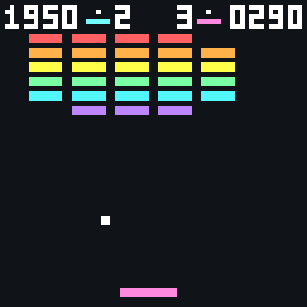
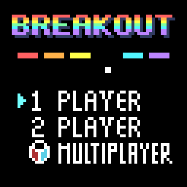
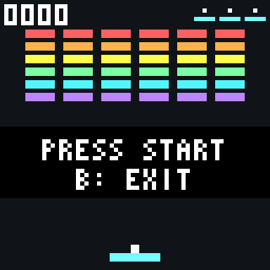
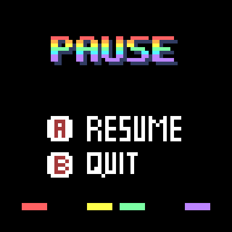
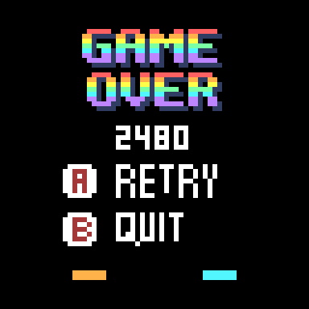
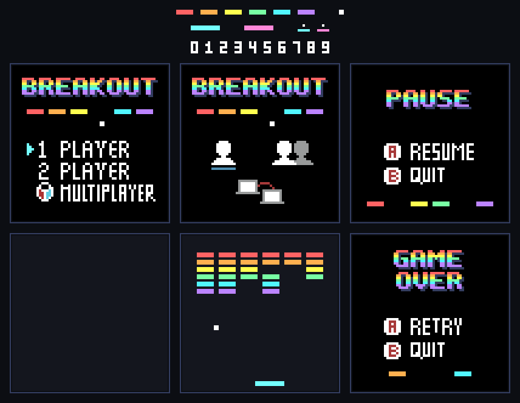

# Breakout

Breakout es el clásico de Atari de 1976 en el que una pelota rebota contra un muro de ladrillos de colores y el jugador la devuelve con una paleta para irlo rompiendo.

En esta versión para KUBIX el jugador debe romper todos los bloques del muro sin dejar caer la pelota. Cada muro despejado da paso a uno nuevo, con la pelota cada vez más rápida.

|  | |
| :---: | :---: |
|  |  |

## Características del juego

- Modo de 1 jugador y modo de 2 jugadores por turnos, cada uno con su propio muro, puntaje y vidas.
- Muro de 36 bloques en seis filas de colores.
- El ángulo de rebote depende de dónde golpea la pelota en la paleta.
- La pelota empieza lenta y acelera un poco con cada bloque roto.
- Pasillos a los costados del muro por donde la pelota puede subir y romper bloques desde arriba.
- Muros sucesivos que empiezan cada vez más rápido.
- Puntaje y vidas en pantalla.
- Pantallas de menú, inicio de partida, pausa y fin de partida.
- Sistema visual basado en sprites.

## Objetivo

Romper todos los bloques posibles sin perder las vidas.

- Cada jugador empieza con **3 vidas**. Dejar caer la pelota quita una.
- Al romper el último bloque aparece el aviso *LEVEL n* y un muro nuevo.
- **2 jugadores:** se turnan. Cuando un jugador pierde la pelota, juega el otro con su propio muro. La partida termina cuando los dos se quedan sin vidas.

| Fila | Puntos |
|---|---|
| Roja (arriba) | 60 |
| Naranja | 50 |
| Amarilla | 40 |
| Verde | 30 |
| Azul | 20 |
| Morada (abajo) | 10 |

## Controles

| Acción | Jugador 1 | Jugador 2 |
|---|---|---|
| Mover la paleta | Flechas izquierda/derecha | J / L |
| Lanzar la pelota | A o flecha arriba | K o I |
| Confirmar en el menú | Enter o A | — |
| Pausar | Enter | — |
| Volver o salir | B | — |

Cada jugador mueve la paleta solo en su turno. En la pausa, **A** (o Enter) reanuda y **B** vuelve al menú. En el fin de partida, **A** juega otra vez y **B** vuelve al menú.

## Pantallas

1. **Menú:** 1 PLAYER, 2 PLAYER o MULTIPLAYER. MULTIPLAYER (partida entre consolas) todavía no está disponible y muestra un aviso.
2. **Inicio de partida:** el muro y la paleta con el mensaje *PRESS START*.
3. **Partida:** la pelota espera sobre la paleta con el aviso *PRESS A* hasta que se lanza. En 2 jugadores, el aviso *PLAYER n* marca cada cambio de turno.
4. **Pausa:** con Enter durante la partida.
5. **Fin de partida:** muestra el puntaje de cada jugador.

| Menú | Inicio | Pausa | Fin de partida |
| :---: | :---: | :---: | :---: |
|  |  |  |  |

## Diseño visual

El juego usa los sprites de [`breakout/assets`](./assets), convertidos a `include/assets.h`. Las posiciones del muro y de la paleta siguen la maqueta `BreakoutPlaying`.

<div align="center">
  
</div>

| Asset | Uso |
|---|---|
| `MainMenuV2` | Menú principal. La flecha de selección se mueve por código. |
| `PauseMenu` | Pantalla de pausa. |
| `GameOverMenu` | Fin de partida; el puntaje se dibuja en la franja libre bajo el título. |
| `Escenario` | Fondo de la partida. |
| `RedBlock`, `OrangeBlock`, `YellowBlock`, `GreenBlock`, `BlueBlock`, `PurpleBlock` | Las seis filas del muro, de arriba abajo. |
| `Ball` | Pelota. |
| `PlayerBT`, `PlayerBT2` | Paleta del jugador 1 (celeste) y del jugador 2 (rosa). |
| `LifeIcon`, `LifeIcon2` | Vidas de cada jugador. |
| `Num0`…`Num9` | Números del marcador. |

`MainMenuV1` (menú con íconos) y `BreakoutPlaying` (maqueta de la partida) están en `breakout/assets` pero el juego no los usa, así que se omiten al generar `assets.h` (`--exclude`) y no ocupan memoria.

## Estructura del proyecto

```text
breakout/
├── CMakeLists.txt
├── README.md
├── forDev.md
├── src/
│   └── main.c
├── include/
│   ├── assets.h
│   ├── basic_font.h
│   └── hal.h
└── img/
    ├── juego.png, menu.png, inicio.png, pausa.png, fin.png
    ├── assets_breakout.png
    └── breakout_demo.gif
```

## Tecnologías utilizadas

- Lenguaje C.
- SDL2.
- CMake.
- Sprites gráficos.
- Sistema de entrada basado en controles.
- Arquitectura orientada a una plataforma de videojuegos retro.

## Ejecución

El proyecto se compila con CMake y SDL2. Para obtener información sobre la compilación y ejecución, consulte [`forDev.md`](./forDev.md).
