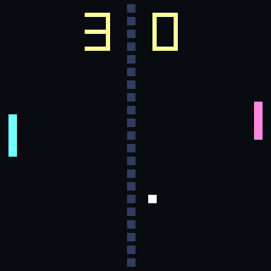
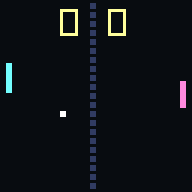
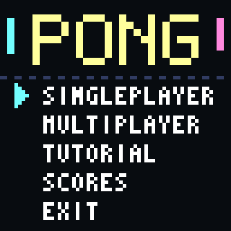
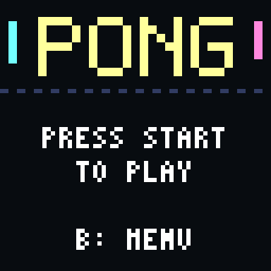
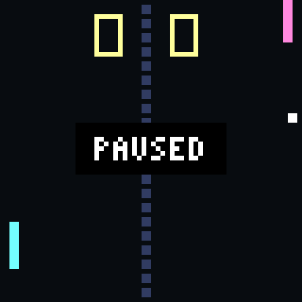
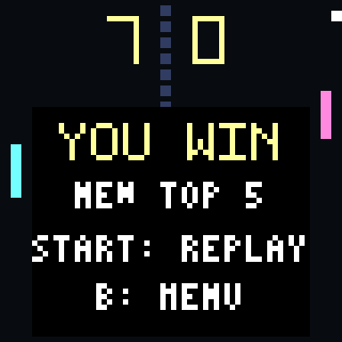
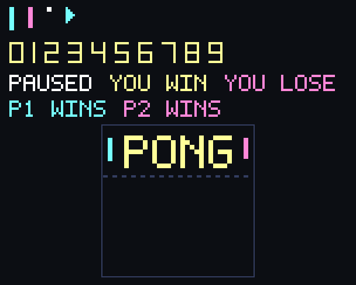

# Pong

Pong es el clásico videojuego de tenis de mesa desarrollado por Atari en 1972, considerado uno de los primeros videojuegos comerciales de la historia.

En este juego, el jugador controla una paleta que se mueve de forma vertical para devolver la pelota al otro lado de la cancha, sin dejarla pasar por su lado.

La experiencia combina reflejos, precisión y anticipación, ya que el ángulo y la velocidad de la pelota cambian según el golpe y la duración del intercambio.

|  | |
| :---: | :---: |
|  |  |

## Características del juego

- Partidas a 7 puntos.
- Modo de un jugador contra la CPU.
- Modo de dos jugadores.
- Tres dificultades de la CPU: Easy, Normal (por defecto) y Hard.
- Ángulo de la pelota según el punto de la paleta en que golpea.
- Aumento de velocidad a medida que se alarga el intercambio.
- Saque con una breve espera después de cada punto.
- Colisiones con las paletas y con las paredes superior e inferior.
- Marcador con dígitos en pantalla.
- Pantallas de inicio, dificultad, pausa, tutorial, puntajes y fin de partida.
- Menús con fondo, título y cursor hechos con sprites.
- Tabla de los 5 mejores puntajes.
- Efectos de sonido.
- Sistema visual basado en sprites.
- Ambientación inspirada en los videojuegos arcade clásicos.

## Objetivo

El objetivo del juego es ser el primero en llegar a 7 puntos.

Durante la partida, el jugador debe:

- Mover la paleta para interceptar la pelota.
- Devolver la pelota con el borde de la paleta para darle ángulo.
- Anticipar los rebotes en las paredes.
- Adaptarse a la velocidad, que aumenta con cada intercambio largo.
- Superar a la CPU o al otro jugador.

## Controles

| Acción | Control |
|---|---|
| Mover la paleta hacia arriba | Flecha arriba |
| Mover la paleta hacia abajo | Flecha abajo |
| Iniciar o pausar | Enter |
| Confirmar | Enter o tecla A |
| Volver | Tecla B |
| Jugador 2: mover hacia arriba | Tecla W |
| Jugador 2: mover hacia abajo | Tecla S |

Los controles equivalentes de la consola son los botones del control NES: arriba, abajo, Start, A y B.

## Pantallas

El flujo de pantallas sigue el [diagrama del menú e inicio de juego](../docs/diagramas): submenú (Singleplayer, Multiplayer, Tutorial, Scores y Exit), pantalla "Press start to play", partida, pausa y fin de partida.

| Menú | Inicio | Pausa | Fin de partida |
| :---: | :---: | :---: | :---: |
|  |  |  |  |

En Multiplayer, si no hay dos controles conectados se muestra el aviso "NEED 2 CONTROLLERS".

## Diseño visual

El juego utiliza una estética inspirada en las máquinas arcade de los años 70.

La paleta de colores y los recursos gráficos fueron diseñados para representar:

- La cancha oscura con la línea central.
- La paleta del jugador 1 (cian) y la del jugador 2 o la CPU (rosa).
- La pelota.
- Los dígitos del marcador.
- El fondo del menú, con el título "PONG" y las paletas a los lados.
- El cursor de selección.
- Los rótulos de pausa y de fin de partida (PAUSED, YOU WIN, YOU LOSE, P1 WINS y P2 WINS).
- La identidad visual retro del juego.

<div align="center">
  
</div>

## Desarrollo del juego

Pong cuenta con una versión desarrollada en lenguaje C, con una estructura orientada a sistemas retro y videojuegos de recursos limitados. Las reglas del juego están separadas de la pantalla y del teclado, por lo que se pueden probar sin SDL2.

Actualmente, el juego cuenta con:

- Submenú con Singleplayer, Multiplayer, Tutorial, Scores y Exit.
- Selección de dificultad.
- Pantalla principal de juego.
- Pantalla de pausa.
- Pantalla de fin de partida con revancha.
- Movimiento de las paletas.
- Movimiento de la pelota con rebotes y ángulos.
- Aceleración de la pelota por intercambio.
- CPU con tres niveles de dificultad.
- Modo de dos jugadores.
- Marcador y detección de la victoria.
- Tabla de los mejores 5 puntajes.
- Sonido al golpear, rebotar y marcar.
- Sprites y fondos gráficos: cancha, paletas, pelota, dígitos, fondo del menú, cursor y rótulos.
- Pruebas automáticas de la lógica y de los tamaños de los sprites.

### Reglas

- La pelota sale hacia quien perdió el punto, después de una breve espera.
- Cada golpe en la paleta divide su altura en 5 zonas: el centro devuelve la pelota recta y los bordes le dan más ángulo.
- Cada 3 golpes seguidos la pelota sube de velocidad, hasta 4 niveles. Al marcar un punto vuelve a la velocidad inicial.
- La CPU se equivoca a propósito. Si el intercambio se alarga, sus errores crecen, así que ningún punto dura para siempre.
- La velocidad de la paleta de la CPU es menor que la del jugador (que se mueve 2 píxeles por cuadro): 0,5 en Easy, 0,75 en Normal y poco más de 1 en Hard. Por eso siempre se le puede ganar apuntando a los bordes de la paleta.
- Las dos paletas miden lo mismo (2×10 píxeles) y están a la misma distancia de su pared, para que el modo de dos jugadores sea justo.

## Estructura de carpetas del juego

```text
pong/
├── CMakeLists.txt
├── README.md
├── forDev.md
├── assets/
│   ├── Ball.png
│   ├── Escenario.png
│   ├── Player1.png
│   ├── Player2.png
│   ├── Num0.png ... Num9.png
│   ├── MenuPong.png
│   ├── MainMenuV1.png, MainMenuV2.png, PauseMenu.png, PongPlaying.png  (diseños del equipo de arte)
│   ├── Cursor.png
│   ├── LabelPaused.png
│   ├── LabelYouWin.png, LabelYouLose.png
│   ├── LabelP1Wins.png, LabelP2Wins.png
│   ├── mixkit-game-ball-tap-2073.wav
│   └── mixkit-video-game-retro-click-237.wav
├── src/
│   ├── main.c
│   └── pong_logica.c
├── include/
│   ├── assets.h
│   ├── basic_font.h
│   ├── hal.h
│   └── pong_logica.h
├── tests/
│   ├── jugadores_bot.h
│   └── pong_tests.c
└── img/
    ├── juego.png, menu.png, inicio.png, pausa.png, fin.png
    ├── assets_pong.png
    └── pong_demo.gif
```

| Carpeta o archivo | Contenido |
|---|---|
| `CMakeLists.txt` | Compilación del juego y de las pruebas con CMake y SDL2. |
| `forDev.md` | Guía de compilación y ejecución. |
| `assets/` | Sprites PNG (cancha, paletas, pelota, dígitos, menú, cursor y rótulos), los menús de diseño del equipo de arte y los efectos de sonido. |
| `src/main.c` | Pantallas, entrada de controles, dibujo y sonido. |
| `src/pong_logica.c` | Reglas: movimiento, colisiones, puntos, CPU y puntajes. No depende de SDL. |
| `include/assets.h` | Sprites en RGB565, generado a partir de [`pong/assets`](./assets) con [`TOOLS/converter.py`](../TOOLS/converter.py). |
| `include/hal.h`, `include/basic_font.h` | Capa de hardware y fuente de texto, las mismas de roadFighter. |
| `include/pong_logica.h` | Interfaz de la lógica del juego. |
| `tests/` | Pruebas automáticas de la lógica y jugadores automáticos para probar la jugabilidad. |
| `img/` | Capturas y animación que se muestran en este README. |

## Tecnologías utilizadas

- Lenguaje C.
- SDL2.
- CMake.
- Sprites gráficos.
- Sistema de entrada basado en controles.
- Aritmética entera, sin `float`, pensada para la CPU RISC-V de KUBIX.
- Arquitectura orientada a una plataforma de videojuegos retro.

## Ejecución

El proyecto puede compilarse utilizando CMake y SDL2.

Para obtener información sobre la compilación y ejecución, consulte:

[`pong/forDev.md`](./forDev.md)

Los sonidos se cargan desde `../assets`, por lo que el juego debe ejecutarse desde la carpeta `build`.

## Pruebas

Las pruebas de la lógica no necesitan SDL2:

```bash
gcc -Wall -Wextra -Wconversion -Iinclude -o pong_tests tests/pong_tests.c src/pong_logica.c
./pong_tests
```

Son 180 pruebas y cubren el 100 % de las líneas de la lógica. Incluyen:

- Colisiones con las paletas y las paredes en los bordes exactos, un subpíxel antes y un subpíxel después.
- Los 5 ángulos de rebote en las dos paletas, y que las dos paletas se comporten como espejo.
- La aceleración, el marcador, los puntajes y el fin de partida.
- La velocidad y el tiempo de reacción de la CPU en cada dificultad.
- Partidas completas con jugadores automáticos y miles de partidas con entradas al azar.
- El equilibrio de las dificultades: un jugador que predice la trayectoria con 3 píxeles de error gana casi siempre en Easy, casi 8 de cada 10 en Normal y alrededor de 15 de cada 100 en Hard.
- Errores inyectados a propósito en la lógica (por ejemplo, un `>` por `>=` o un signo cambiado): las pruebas detectan 37 de 37.

## Assets

Los recursos del juego se encuentran en:

[`pong/assets/`](./assets)

Estos recursos incluyen los sprites de la cancha, las paletas, la pelota, los dígitos del marcador, el fondo del menú, el cursor y los rótulos, además de los dos efectos de sonido. El archivo `include/assets.h` se genera a partir de los PNG con [`TOOLS/converter.py`](../TOOLS/converter.py) y las opciones `--macros` y `--exclude`.

La misma carpeta guarda los diseños del equipo de arte (`MainMenuV1`, `MainMenuV2`, `PauseMenu` y `PongPlaying`); el juego aún no los usa, así que se omiten al generar `assets.h` (`--exclude`) y no ocupan memoria. `Player2` mide 2×10, igual que la paleta de la lógica del juego.

## Límites conocidos

- El soporte de FPGA para el segundo control NES y para el audio por I2S no está documentado todavía. En FPGA, `connectedControls()` devuelve 1 y el sonido queda a cargo de `playSound()` del HAL.
- Los puntajes se guardan solo en memoria mientras corre el juego y no piden nombre.
- La fuente de 3×5 del HAL no dibuja bien la `W`, el `7` ni el `!`. Los rótulos con `W` son sprites y el tutorial y los puntajes usan la fuente de 5×7.
- Las opciones de los menús, la lista de puntajes y las pistas de botones siguen siendo texto de la fuente del HAL, porque cambian de contenido.
- El menú general de KUBIX está en [`menu`](../menu) y abre este juego como un programa aparte. La función `backToGeneralMenu()` de [`src/main.c`](./src/main.c) es el punto de enganche: hoy termina el programa y con eso se vuelve al menú; en la FPGA el menú y los juegos tendrán que compilarse juntos.
