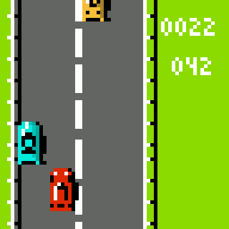
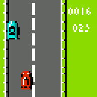
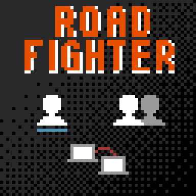
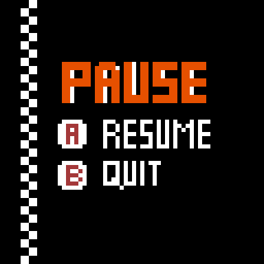
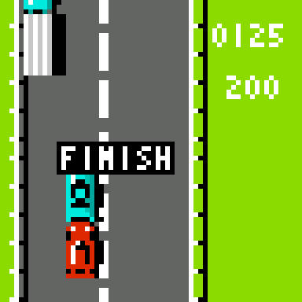
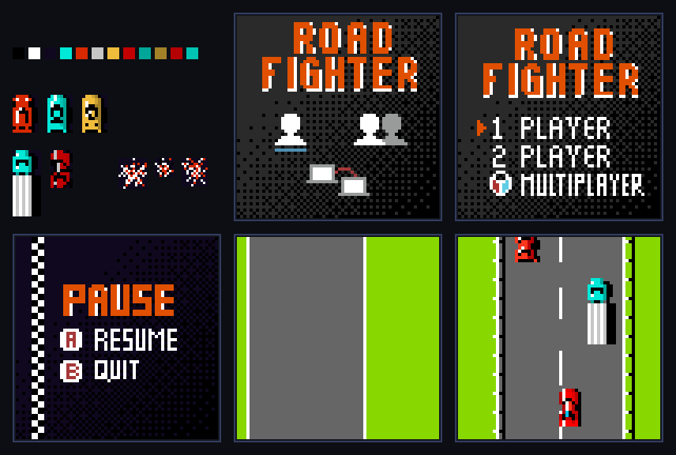

# Road Fighter

Road Fighter es el clásico videojuego de carreras desarrollado y publicado por Konami en 1984, considerado uno de los pioneros del género de carreras de vista cenital (top-down).

En este juego, el jugador controla un automóvil de carreras rojo que debe avanzar por la carretera, esquivar otros vehículos y llegar a la meta.

En esta versión para KUBIX el auto acelera, frena y cambia de carril entre el tráfico, mientras un tablero lateral muestra el tiempo y la distancia recorrida hasta la meta de 200 metros.

|  | |
| :---: | :---: |
|  |  |

## Características del juego

- Carretera de 4 carriles con desplazamiento vertical continuo (vallas y líneas que se mueven según la velocidad).
- Auto del jugador con aceleración y frenado progresivos (velocidad máxima de 10).
- Tráfico de 18 vehículos (autos azules, autos amarillos y camiones) repartidos a lo largo del recorrido.
- Detección de colisiones con el tráfico: el auto se muestra destruido unos instantes.
- Cronómetro (minutos y segundos) y contador de distancia en metros.
- Meta a los 200 metros: aparece el mensaje *FINISH* y el tiempo se detiene.
- Pantalla de pausa y pantalla de inicio.
- Sistema visual basado en sprites.

## Objetivo

Llegar a la meta, 200 metros más adelante, en el menor tiempo posible.

Durante el recorrido, el jugador debe:

- Esquivar los vehículos del tráfico cambiando de carril.
- Acelerar sin perder el control del auto.
- Mantener el ritmo para que el cronómetro marque el mejor tiempo.

## Controles

| Acción | Control |
|---|---|
| Acelerar | Flecha arriba |
| Frenar | Flecha abajo |
| Mover hacia la izquierda | Flecha izquierda |
| Mover hacia la derecha | Flecha derecha |
| Pausar la partida | Enter |
| Reanudar (en la pausa) o jugar (en la pantalla de inicio) | Tecla A |
| Salir de la pausa a la pantalla de inicio | Tecla B |

## Pantallas

1. **Partida:** el juego arranca directamente en la carretera. A la derecha se ven el tiempo (minutos y segundos) y la distancia en metros.
2. **Pausa:** con Enter durante la partida. A reanuda y B sale a la pantalla de inicio.
3. **Pantalla de inicio:** el logotipo con los modos 1 PLAYER, 2 PLAYER y MULTIPLAYER; con A se vuelve a la partida. Hoy es solo una imagen: no se puede elegir un modo.
4. **Meta:** al llegar a los 200 metros aparece *FINISH* y el tiempo queda congelado.

| Menú | Pausa | Meta |
| :---: | :---: | :---: |
|  |  |  |

## Diseño visual

El juego usa los sprites de [`assets/roadFighters`](../assets/roadFighters), convertidos a `include/assets.h`. La estética se inspira en las máquinas arcade de carreras de los años 80.

<div align="center">
  
</div>

| Asset | Uso |
|---|---|
| `MainMenu` | Pantalla de inicio. |
| `PauseMenu` | Pantalla de pausa. |
| `SimplerRoad` | Fondo de la carretera. |
| `fences`, `roadLines` | Vallas y líneas que se desplazan sobre la carretera. |
| `RedCar` | Auto del jugador. |
| `BlueCar`, `YellowCar`, `Truck` | Vehículos del tráfico. |
| `CarDestroyed` | Auto del jugador tras un choque. |

`CarFront`, `Crash1`, `Crash2`, `Crash3`, `MainMenuV2` y `RoadFighterPlaying` se incluyen en `assets.h` pero no se usan todavía. `Road` solo se usa en una pantalla de ajustes a la que aún no se llega desde el juego.

## Estructura del proyecto

```text
roadFighter/
├── CMakeLists.txt
├── README.md
├── forDev.md
├── src/
│   └── main.c
├── include/
│   ├── assets.h
│   ├── basic_font.h
│   └── hal.h
└── img/
    ├── juego.png, menu.png, pausa.png, fin.png
    ├── assets_road_fighter.png
    └── road_fighter_demo.gif
```

## Tecnologías utilizadas

- Lenguaje C.
- SDL2.
- CMake.
- Sprites gráficos.
- Sistema de entrada basado en controles.
- Arquitectura orientada a una plataforma de videojuegos retro.

## Ejecución

El proyecto se compila con CMake y SDL2. Para obtener información sobre la compilación y ejecución, consulte [`forDev.md`](./forDev.md).

## Límites conocidos

- Los choques solo muestran el auto destruido: todavía no restan velocidad, vidas ni puntos.
- El tráfico va a velocidad constante y en posiciones fijas; no hay combustible ni varias etapas.
- No hay modo de 2 jugadores ni MULTIPLAYER, y la pantalla de inicio no permite elegir un modo.
- No hay puntaje ni lista de mejores tiempos.
- Al llegar a la meta no hay pantalla de fin ni forma de reiniciar la carrera sin cerrar el programa.
- Salir de la pausa lleva a la pantalla de inicio, pero todavía no se vuelve al menú general de KUBIX: ver [`menu`](../menu).
