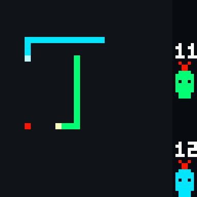
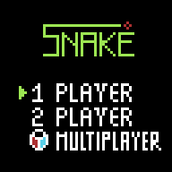
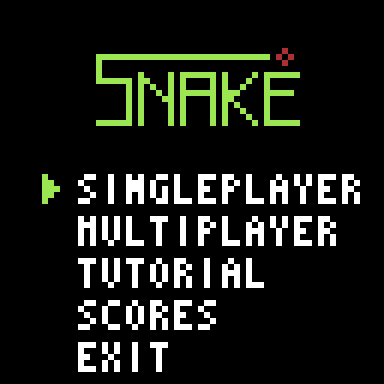
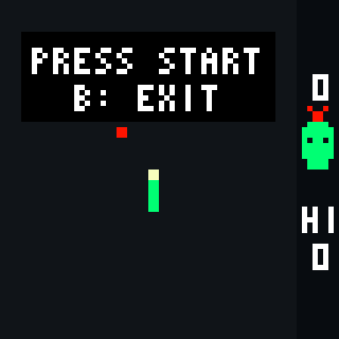
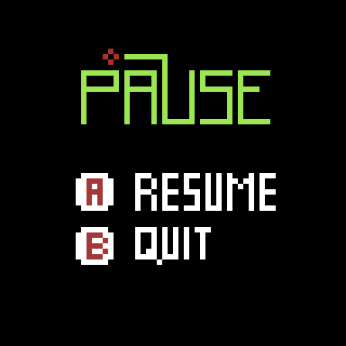
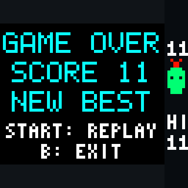
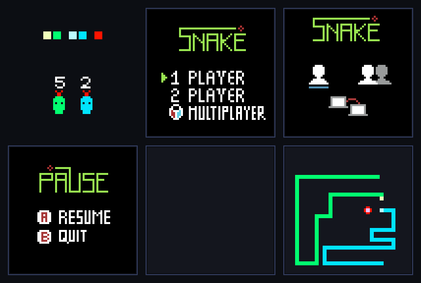

# Snake

Snake es uno de los juegos más clásicos de los arcades y de los primeros teléfonos móviles: una serpiente avanza sin detenerse por el tablero, come manzanas y crece con cada una.

En esta versión para KUBIX el jugador guía la serpiente con el control, debe evitar chocar con su propio cuerpo y, en el modo de dos jugadores, también con la serpiente rival.

|  | |
| :---: | :---: |
|  |  |

## Características del juego

- Modo de 1 jugador y modo de 2 jugadores en la misma consola.
- Tablero de 28 × 32 casillas con bordes que se traspasan.
- La serpiente crece y el juego se acelera con cada manzana.
- Manzanas en posiciones aleatorias, siempre en una casilla libre.
- Panel lateral con el puntaje de cada jugador.
- Récord de la sesión en el modo de 1 jugador.
- Pantallas de menú, inicio de partida, pausa y fin de partida.
- Sistema visual basado en sprites.

## Objetivo

Comer la mayor cantidad de manzanas posible sin chocar.

- **1 jugador:** la partida termina cuando la serpiente choca con su propio cuerpo. Si llena todo el tablero, gana.
- **2 jugadores:** pierde quien choque con su cuerpo o con la otra serpiente. Si las cabezas chocan entre sí, es empate.

Cada manzana suma 1 punto y alarga la serpiente una casilla.

## Controles

| Acción | Jugador 1 | Jugador 2 |
|---|---|---|
| Mover | Flechas | W, A, S, D |
| Confirmar en el menú | Enter o A | — |
| Pausar / reanudar | Enter | — |
| Volver o salir | B | — |

En la pausa, **A** (o Enter) reanuda y **B** vuelve al menú. La tecla A también es el botón A del jugador 1, pero ese botón no se usa durante la partida.

## Pantallas

1. **Menú:** 1 PLAYER, 2 PLAYER o MULTIPLAYER. MULTIPLAYER (partida entre consolas) todavía no está disponible y muestra un aviso.
2. **Inicio de partida:** el tablero con las serpientes en su lugar y el mensaje *PRESS START*.
3. **Partida.**
4. **Pausa:** con Enter durante la partida.
5. **Fin de partida:** muestra el resultado; Enter juega otra vez y B vuelve al menú.

| Menú | Inicio | Pausa | Fin de partida |
| :---: | :---: | :---: | :---: |
|  |  |  |  |

## Diseño visual

El juego usa los sprites de [`assets/snake`](../assets/snake), convertidos a `include/assets.h`.

<div align="center">
  
</div>

| Asset | Uso |
|---|---|
| `MainMenuV2` | Menú principal. La flecha de selección se mueve por código. |
| `PauseMenu` | Pantalla de pausa. |
| `Escenario` | Fondo del tablero. |
| `SnakeHead1`, `SnakeBody1` | Serpiente del jugador 1 (verde). |
| `SnakeHead2`, `SnakeBody2` | Serpiente del jugador 2 (azul). |
| `Apple` | Manzana. |
| `SnakeLateral2Playing` | Panel de puntaje del jugador 1 (verde). |
| `SnakeLateral1Playing` | Panel de puntaje del jugador 2 (azul). |

`MainMenuV1` (menú con íconos) y `SnakePlaying` (maqueta de la partida) están en `assets/snake` pero el juego no los usa, así que se omiten al generar `assets.h` (`--exclude`) y no ocupan memoria.

## Estructura del proyecto

```text
snake/
├── CMakeLists.txt
├── README.md
├── forDev.md
├── src/
│   └── main.c
├── include/
│   ├── assets.h
│   ├── basic_font.h
│   └── hal.h
└── img/
    ├── juego.png, menu.png, inicio.png, pausa.png, fin.png
    ├── assets_snake.png
    └── snake_demo.gif
```

## Tecnologías utilizadas

- Lenguaje C.
- SDL2.
- CMake.
- Sprites gráficos.
- Sistema de entrada basado en controles.
- Arquitectura orientada a una plataforma de videojuegos retro.

## Ejecución

El proyecto se compila con CMake y SDL2. Para obtener información sobre la compilación y ejecución, consulte [`forDev.md`](./forDev.md).
