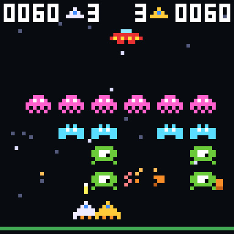
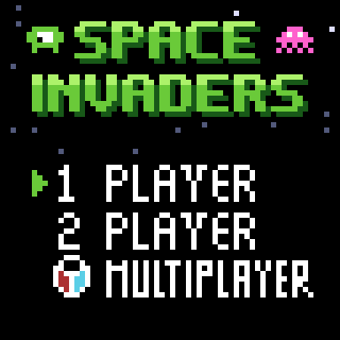
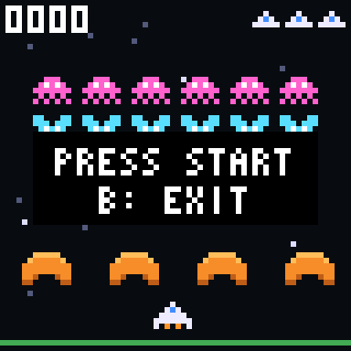
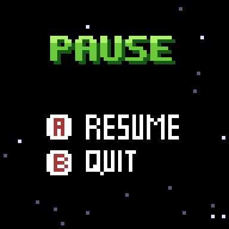
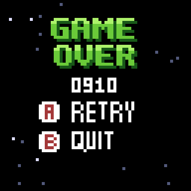
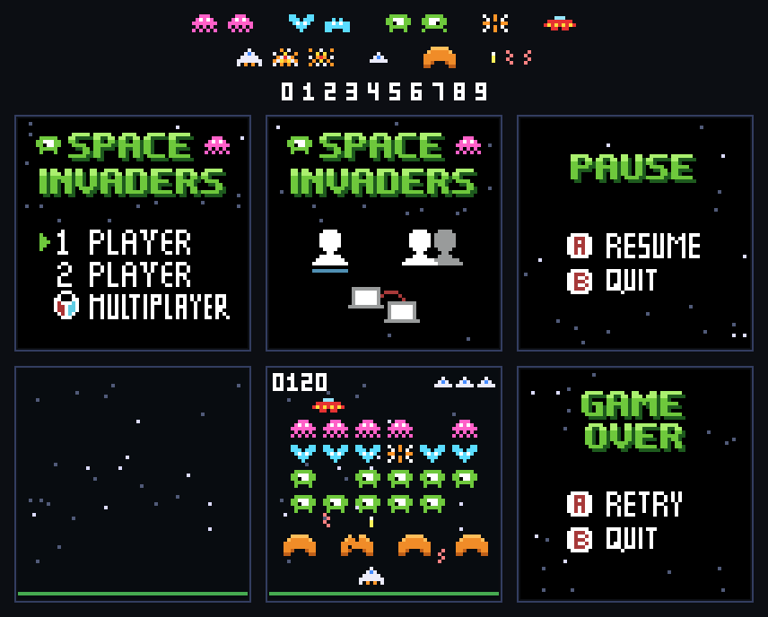

# Space Invaders

Un juego de disparos de pantalla fija al estilo de los arcades clásicos: una formación de aliens avanza de lado a lado y baja cada vez que toca un borde, mientras el jugador la ataca desde abajo con su nave.

En esta versión para KUBIX el jugador debe destruir cada oleada antes de que los aliens lleguen al suelo, protegiéndose detrás de las barreras y esquivando los disparos enemigos.

|  | |
| :---: | :---: |
|  |  |

## Características del juego

- Modo de 1 jugador y modo de 2 jugadores cooperativo, con las dos naves al mismo tiempo en pantalla.
- Formación de 24 aliens de tres tipos, con animación de dos cuadros.
- La formación acelera a medida que pierde aliens y en cada oleada nueva.
- Oleadas sucesivas que empiezan cada vez más abajo.
- Ovni que cruza la parte de arriba y da puntos extra.
- Barreras que se rompen con los disparos y con los aliens que las alcanzan.
- Puntaje y vidas en pantalla.
- Pantallas de menú, inicio de partida, pausa y fin de partida.
- Sistema visual basado en sprites.

## Objetivo

Destruir todas las oleadas de aliens posibles sin perder las vidas.

- Cada nave empieza con **3 vidas**. Un disparo alien quita una.
- Si los aliens llegan a la altura de las naves, la partida termina.
- En 2 jugadores, la partida sigue mientras alguna de las dos naves tenga vidas.

| Objetivo | Puntos |
|---|---|
| Medusa rosa (fila de arriba) | 30 |
| Murciélago celeste | 20 |
| Cíclope verde (filas de abajo) | 10 |
| Ovni | 50, 100, 150 o 300 |

## Controles

| Acción | Jugador 1 | Jugador 2 |
|---|---|---|
| Mover | Flechas izquierda/derecha | J / L |
| Disparar | A o flecha arriba | K o I |
| Confirmar en el menú | Enter o A | — |
| Pausar | Enter | — |
| Volver o salir | B | — |

Solo puede haber un disparo de cada nave en pantalla; mantener el botón vuelve a disparar en cuanto el anterior desaparece. En la pausa, **A** (o Enter) reanuda y **B** vuelve al menú. En el fin de partida, **A** juega otra vez y **B** vuelve al menú.

## Pantallas

1. **Menú:** 1 PLAYER, 2 PLAYER o MULTIPLAYER. MULTIPLAYER (partida entre consolas) todavía no está disponible y muestra un aviso.
2. **Inicio de partida:** la formación y las naves en su lugar con el mensaje *PRESS START*.
3. **Partida:** entre oleadas aparece el aviso *WAVE n*.
4. **Pausa:** con Enter durante la partida.
5. **Fin de partida:** muestra el puntaje de cada jugador.

| Menú | Inicio | Pausa | Fin de partida |
| :---: | :---: | :---: | :---: |
|  |  |  |  |

## Diseño visual

El juego usa los sprites de [`assets/spaceInvaders`](../assets/spaceInvaders), convertidos a `include/assets.h`.

<div align="center">
  
</div>

| Asset | Uso |
|---|---|
| `MainMenuV2` | Menú principal. La flecha de selección se mueve por código. |
| `PauseMenu` | Pantalla de pausa. |
| `GameOverMenu` | Fin de partida; el puntaje se dibuja en la franja libre bajo el título. |
| `Escenario` | Fondo de estrellas con el suelo. |
| `AlienA1/A2`, `AlienB1/B2`, `AlienC1/C2` | Los tres tipos de alien, con sus dos cuadros. |
| `AlienExplosion` | Alien destruido. |
| `Ufo` | Ovni. |
| `Player`, `PlayerExplosion1/2` | Nave y su explosión. El jugador 2 usa la misma nave pintada de amarillo. |
| `Bunker` | Barrera. Cada una es una copia que se va rompiendo píxel a píxel. |
| `PlayerBullet`, `AlienBullet1/2` | Disparos. |
| `LifeIcon`, `Num0`…`Num9` | Vidas y números del marcador. |

`MainMenuV1` (menú con íconos) y `SpaceInvadersPlaying` (maqueta de la partida) se incluyen en `assets.h` pero no se usan.

## Estructura del proyecto

```text
space_invaders/
├── CMakeLists.txt
├── README.md
├── forDev.md
├── src/
│   └── main.c
├── include/
│   ├── assets.h
│   ├── basic_font.h
│   └── hal.h
└── img/
    ├── juego.png, menu.png, inicio.png, pausa.png, fin.png
    ├── assets_space_invaders.png
    └── space_invaders_demo.gif
```

## Tecnologías utilizadas

- Lenguaje C.
- SDL2.
- CMake.
- Sprites gráficos.
- Sistema de entrada basado en controles.
- Arquitectura orientada a una plataforma de videojuegos retro.

## Ejecución

El proyecto se compila con CMake y SDL2. Para obtener información sobre la compilación y ejecución, consulte [`forDev.md`](./forDev.md).
